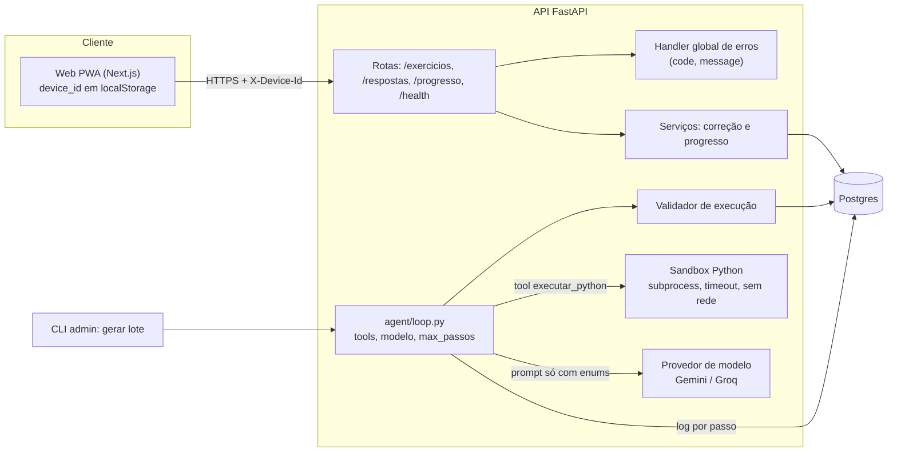

# Arquitetura

Requisitos em [SPEC.md](../SPEC.md).

## Stack
- **web:** Next.js (PWA, mobile-first), deploy no Vercel.
- **api:** FastAPI + SQLAlchemy + Alembic, deploy em container (Render ou Fly).
- **banco:** Postgres (Neon).
- **modelos:** provedor abstrato com 2 ou mais implementações (Gemini e Groq, tier gratuito).
- **monorepo:** npm workspaces para o front; a API é uma pasta Python independente.

## Diagrama

## Decisões
- **Correção determinística:** o cliente envia só índices. O servidor compara com o gabarito validado. Nenhum texto livre do usuário chega a modelo ou executor (REQ-008, REQ-036).
- **Dois agentes:** o gerador recebe só enums e tem a tool `executar_python`. O explicador recebe id do exercício e opção escolhida, sem tool de execução (REQ-012, REQ-037).
- **Geração fora do caminho do usuário:** só a CLI administrativa gera. A requisição do usuário lê o estoque validado (REQ-024).
- **Aparelho anônimo:** `device_id` UUID v4 gerado no cliente, enviado no header `X-Device-Id`. Sem login (REQ-014, REQ-015).

## Modelo de dados
- **exercicios:** id (uuid), tipo, nivel, tema (enums), enunciado, codigo, opcoes (jsonb), gabarito (jsonb), saida_esperada, explicacao, explicacoes_por_opcao (jsonb), status (`validado` ou `arquivado`), geracao_id (fk), criado_em.
- **tentativas:** id, device_id (uuid), exercicio_id (fk), resposta (jsonb com índices), correta (bool), criado_em. Índice em (device_id, criado_em).
- **execucoes_geracao:** id, tipo, nivel, tema (enums pedidos), modelo, provedor, status (`aprovado`, `rejeitado` ou `falhou`), motivo, passos, duracao_ms, criado_em.
- **passos_geracao:** id, execucao_id (fk), n, tool, modelo, entrada_resumo, resultado_resumo, duracao_ms, criado_em. Persiste o log estruturado do loop, além do log em stdout (REQ-020).
- O progresso é derivado de `tentativas` por consulta; não há tabela de usuário.

## Fluxo gerar, validar, salvar
1. A CLI administrativa chama `gerar(tipo, nivel, tema)`, só com enums.
2. `loop.py` monta o prompt, chama o modelo com limite de N passos e loga cada passo.
3. O modelo pode chamar a tool `executar_python(codigo)` para testar o próprio código; o resultado volta ao modelo.
4. O modelo devolve o JSON final e o servidor valida o schema (REQ-030).
5. O validador independente re-executa o código no sandbox e compara com a saída afirmada, mais as checagens do tipo. Nunca confia no que o modelo diz ter executado (CLAUDE.md, regra 3).
   - `ordenar_linhas`: executa a ordem correta e confere que ao menos uma permutação errada muda a saída ou falha.
   - `achar_bug`: executa a versão com bug e a corrigida e confere que diferem.
6. Aprovado: INSERT em `exercicios` com `status = validado`. Rejeitado: só `execucoes_geracao`, com o motivo.
7. A requisição do usuário nunca dispara geração.

## Riscos conhecidos
- Limites de recurso do sandbox (rlimit) só funcionam em Linux; o container da API é o ambiente de referência.
- Cota dos modelos gratuitos nos evals: casos pequenos, resultados gravados para o CI determinístico.
