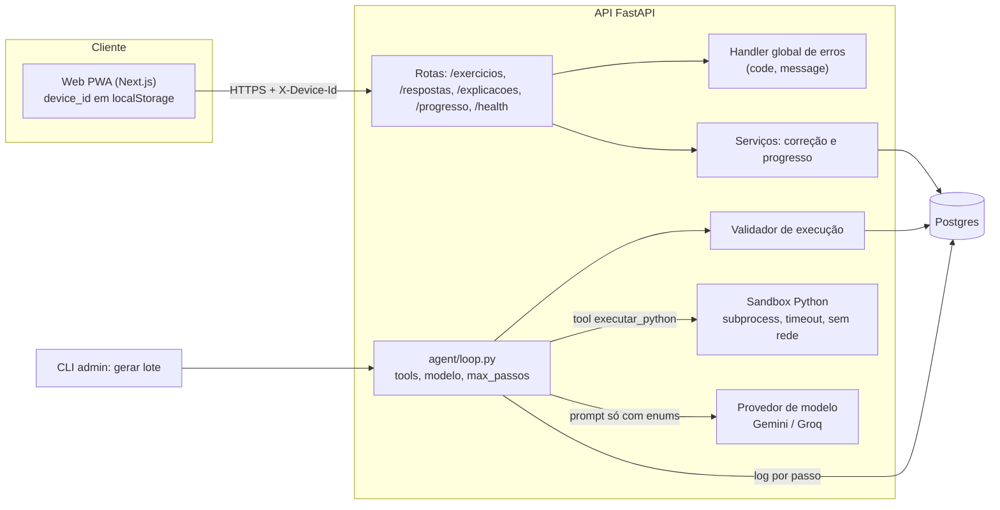

# Arquitetura

Requisitos em [SPEC.md](../SPEC.md).

## Stack
- **web:** Next.js (PWA, mobile-first), deploy no Vercel.
- **api:** FastAPI + SQLAlchemy + Alembic, deploy em container (Render ou Fly).
- **banco:** Postgres (Neon).
- **modelos:** provedor abstrato com 2 ou mais implementações (Gemini e Groq, tier gratuito).
- **monorepo:** npm workspaces para o front; a API é uma pasta Python independente.

## Diagrama

## Decisões
- **Correção determinística:** o cliente envia só índices. O servidor compara com o gabarito validado. Nenhum texto livre do usuário chega a modelo ou executor (REQ-008, REQ-036).
- **Dois agentes:** o gerador recebe só enums e tem a tool `executar_python`. O explicador recebe só dados estruturados (id e opção escolhida, ou exercício e resposta numérica) e nunca tem tool de execução (REQ-012, REQ-037).
- **Geração fora do caminho do usuário:** só a CLI administrativa gera. A requisição do usuário lê o estoque validado (REQ-024).
- **Aparelho anônimo:** `device_id` UUID v4 gerado no cliente, enviado no header `X-Device-Id`. Sem login (REQ-014, REQ-015). O servidor aceita UUID válido de qualquer versão; ausente ou malformado é `DEVICE_INVALIDO` (D-16).

## Decisões do contrato
Resumo de [decisoes-contrato.md](decisoes-contrato.md) (D-01 a D-34), que guarda motivo e alternativas descartadas.

**Enums (D-01 a D-03).** Tipos: `prever_saida`, `completar_lacuna`, `ordenar_linhas`, `achar_bug`. Níveis: `iniciante`, `intermediario`, `avancado`. Temas: `variaveis`, `condicionais`, `lacos`, `listas`, `funcoes`, `strings`, `dicionarios`, `erros`.

**Rotas e payloads (D-09, D-10, D-12, D-34).**
- `GET /exercicios?tipo&nivel&tema` → `{id, tipo, nivel, tema, enunciado, codigo, opcoes}`. Nunca inclui `gabarito`, `saida_esperada`, `explicacao` nem `explicacoes_por_opcao`.
- `POST /respostas` `{exercicio_id, resposta}` → `{correta, explicacao}`, sem gabarito. Toda resposta válida registra tentativa (D-11).
- `POST /explicacoes` `{exercicio_id, resposta}` → `{explicacao}`; não registra tentativa (REQ-045).
- `GET /progresso` → `{total_acertos, taxa_por_tipo, sequencia_dias}`; sequência no fuso `America/Sao_Paulo`.
- `GET /health` → 200 `{"status":"ok","db":"ok"}` ou 503 `{"status":"degraded","db":"erro"}`; sem rate limit e fora do formato `{code, message}` (D-04).

**Formato das respostas por tipo (D-06).** `prever_saida`, `completar_lacuna` e `achar_bug` respondem 1 índice. `ordenar_linhas` responde pares `[índice, nível de indentação]`, um por peça, nível 0 a 3 (4 espaços por nível); `opcoes` guarda as linhas sem indentação e `gabarito` a ordem correta no mesmo formato. `completar_lacuna` marca a lacuna com `___`; `achar_bug` usa as linhas do código como `opcoes`.

**Erros (D-14, D-15).** Sempre `{code, message}`; `ERRO_INTERNO` leva também `correlacao_id`, o mesmo id do log com o stack trace.

| code | HTTP |
|---|---|
| `SEM_EXERCICIO`, `EXERCICIO_NAO_ENCONTRADO`, `NAO_ENCONTRADO` | 404 |
| `RESPOSTA_INVALIDA`, `FILTRO_INVALIDO`, `ENUM_INVALIDO` | 422 |
| `DEVICE_INVALIDO` | 400 |
| `METODO_NAO_PERMITIDO` | 405 |
| `LIMITE_EXCEDIDO` | 429 |
| `INDISPONIVEL` | 503 |
| `ERRO_INTERNO` | 500 |

**Explicação do erro (D-17, D-34).** Usa-se `explicacoes_por_opcao[opção]` armazenada, na hora; o explicador só entra nesse caminho se a opção não tiver explicação. Falha ou 5 s de espera caem na `explicacao` geral. "Explicar meu erro" (REQ-045) chama `explicar_resposta(exercicio_id, resposta, *, provedor)`, sem tools; resposta correta devolve a explicação geral sem chamar o agente.

**Agente e validação (D-18 a D-22).** `gerar(tipo, nivel, tema, *, provedor, executor, max_passos)`, padrão de 5 passos; exercício final inválido ⇒ `rejeitado`, limite de passos ⇒ `falhou`. Log por passo em JSON (`execucao, passo, tool, modelo, duracao_ms, resultado`). Provedor por `MODEL_PROVIDER` e `MODEL_NAME` (`app.config.carregar_provedor()`). `app.cli.gerar_lote` gera até o estoque validado chegar ao mínimo, com no máximo `minimo × 3` tentativas. O validador confere o schema antes de executar e compara a saída ignorando espaço no fim de linha e linhas vazias no fim.

**`ordenar_linhas` (D-08).** Válido só se exatamente 1 combinação de ordem e indentação executa com a saída esperada. A busca poda pela gramática do Python (1ª linha sem indentar; após linha terminada em `:` o nível sobe 1; nas demais nunca sobe), descarta o que não faz parse e executa o resto. Até 6 peças e 400 execuções; acima disso, reprova.

**Sandbox (D-23).** Lista de permissão de imports (`math`, `itertools`, `collections`, `string`, `functools`, `statistics`, `time`); timeout 2 s, 128 MB, saída até 1 MB. Memória e fork bomb exigem Linux e rodam no CI (`ubuntu-latest`) sem poder ser pulados. Ver [SECURITY.md](../SECURITY.md).

**Rate limit e CORS (D-24, D-25).** 120 req/min por aparelho e 300 req/min por IP (`LIMITE_EXCEDIDO`); IP lido da conexão, `X-Forwarded-For` só com `TRUST_PROXY=1`. CORS só para `CORS_ORIGIN`, métodos `GET`, `POST`, `OPTIONS`, headers `X-Device-Id` e `Content-Type`.

**Front (D-29 a D-31).** Telas em `apps/web/app`, código de apoio em `apps/web/lib` (`device-id.ts`, `api.ts`); não há `apps/web/src`. `chamarApi` rejeita com `{code, message}`; falha de rede vira `SEM_CONEXAO`. Semente do e2e: `python -m app.cli semear-e2e`.

**Pacotes da API (D-27).** `app.errors`, `app.db`, `app.models`, `app.sandbox`, `app.validador`, `app.agent.loop`, `app.agent.explicador`, `app.config`, `app.cli`, `app.ratelimit`. Testes usam `TEST_DATABASE_URL` (SQLite por padrão); `tzdata` entra nas dependências.

## Modelo de dados
- **exercicios:** id (uuid), tipo, nivel, tema (enums, ver Decisões do contrato), enunciado, codigo, **codigo_corrigido** (só `achar_bug`, D-07), opcoes (jsonb), gabarito (jsonb), saida_esperada (em `achar_bug`, a saída da versão corrigida), explicacao, explicacoes_por_opcao (jsonb), status (`validado` ou `arquivado`), geracao_id (fk), criado_em.
- **tentativas:** id, device_id (uuid), exercicio_id (fk), resposta (jsonb com índices; pares `[índice, indentação]` em `ordenar_linhas`), correta (bool), criado_em. Índice em (device_id, criado_em).
- **execucoes_geracao:** id, tipo, nivel, tema (enums pedidos), modelo, provedor, status (`aprovado`, `rejeitado` ou `falhou`), motivo, passos, duracao_ms, criado_em.
- **passos_geracao:** id, execucao_id (fk), n, tool, modelo, entrada_resumo, resultado_resumo, duracao_ms, criado_em. Persiste o log estruturado do loop, além do log em stdout (REQ-020).
- O progresso é derivado de `tentativas` por consulta; não há tabela de usuário.

## Fluxo gerar, validar, salvar
1. A CLI administrativa chama `gerar(tipo, nivel, tema)`, só com enums.
2. `loop.py` monta o prompt, chama o modelo com limite de N passos e loga cada passo.
3. O modelo pode chamar a tool `executar_python(codigo)` para testar o próprio código; o resultado volta ao modelo.
4. O modelo devolve o JSON final e o servidor valida o schema (REQ-030).
5. O validador independente re-executa o código no sandbox e compara com a saída afirmada, mais as checagens do tipo. Nunca confia no que o modelo diz ter executado (CLAUDE.md, regra 3).
   - `ordenar_linhas`: executa a ordem e a indentação corretas e confere que nenhuma outra combinação produz a mesma saída (D-08).
   - `achar_bug`: executa a versão com bug e a corrigida (`codigo_corrigido`) e confere que diferem e que a corrigida dá a `saida_esperada`.
6. Aprovado: INSERT em `exercicios` com `status = validado`. Rejeitado: só `execucoes_geracao`, com o motivo.
7. A requisição do usuário nunca dispara geração.

## Riscos conhecidos
- Limites de recurso do sandbox (rlimit) só funcionam em Linux; o container da API é o ambiente de referência.
- Cota dos modelos gratuitos nos evals: casos pequenos, resultados gravados para o CI determinístico.
